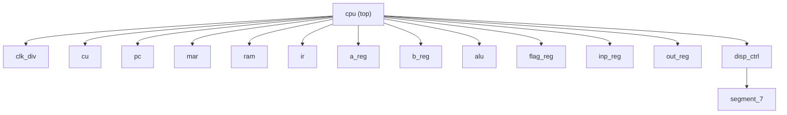

<p align="center">
  
</p>

<h1 align="center">8-Bit Computer in Verilog</h1>

<p align="center">
  
  
  
  
  
  
</p>

<p align="center">
  A custom 8-bit accumulator computer with a shared bus, a multi-cycle FSM control unit, and a seven-segment output, written in Verilog and built for FPGA.
</p>

---

## Table of Contents

- [Project Overview](#project-overview)
- [Project Highlights](#project-highlights)
- [Specifications](#specifications)
- [Architecture Overview](#architecture-overview)
- [Instruction Set Architecture (ISA)](#instruction-set-architecture-isa)
- [Control Signals](#control-signals)
- [Instruction Execution (T-States)](#instruction-execution-t-states)
- [ALU and Flags](#alu-and-flags)
- [RTL Module Structure](#rtl-module-structure)
- [RAM and Program Initialization](#ram-and-program-initialization)
- [Clocking and Reset](#clocking-and-reset)
- [Example Program: Fibonacci](#example-program-fibonacci)
- [Simulation and Verification](#simulation-and-verification)
- [FPGA Implementation](#fpga-implementation)
- [Repository Structure](#repository-structure)
- [Getting Started](#getting-started)
- [Future Improvements](#future-improvements)
- [Authors](#authors)
- [License](#license)

---

## Project Overview

This project implements a custom 8-bit computer in Verilog HDL. It is inspired by SAP (Simple-As-Possible) style educational CPUs and is built from small, modular datapath components sequenced by a multi-cycle finite-state machine (FSM).

The goal is to show how a processor actually works: fetching instructions, decoding opcodes, moving data between registers over a shared bus, performing ALU operations, accessing RAM, and controlling program flow.

> [!NOTE]
> This README reflects the design as documented so far. Before treating the tables as a cycle-accurate specification, confirm signal behavior and FSM transitions against the current RTL.

---

## Project Highlights

- 8-bit accumulator-based CPU written entirely in Verilog HDL.
- 16-instruction custom ISA covering arithmetic, logic, shifts, memory, branching, and I/O.
- Shared 8-bit internal bus, with control signals on dedicated wires.
- Multi-cycle FSM control unit using T-state sequencing.
- 16 x 8 RAM initialized from a `.mem` file via `$readmemb`.
- Zero and Carry flags with conditional jumps (`JZ`, `JC`).
- External input with a confirm-to-continue handshake and a four-digit seven-segment output.
- Clock divider for visible, step-by-step execution on hardware.
- Targets the Real Digital Boolean board (Xilinx Spartan-7 `XC7S50-CSGA324-1`) using AMD Vivado.

---

## Specifications

| Feature | Implementation |
|---|---|
| HDL | Verilog |
| Architecture | Accumulator-based, shared bus |
| Data width | 8 bits |
| Program counter width | 4 bits |
| Memory address width | 4 bits |
| RAM | 16 x 8 bits |
| Instruction width | 8 bits |
| Opcode | Instruction bits `[7:4]` |
| Operand | Instruction bits `[3:0]` |
| Control | Multi-cycle FSM with T-state sequencing |
| Instruction set | 16 instructions |
| FPGA clock | 100 MHz board clock, divided for the CPU |
| Output | Four-digit seven-segment display controller |
| Program loading | `$readmemb` from a `.mem` file |
| Target FPGA | Xilinx/AMD `XC7S50-CSGA324-1` |
| Tool | AMD Vivado |

---

## Architecture Overview

The CPU is split into a **datapath** and a **control unit**.

- **Datapath:** PC, MAR, RAM, IR, A register, B register, ALU, flag register, input register, output register, and the shared bus.
- **Control unit (CU):** decodes the current opcode and FSM state, then asserts control signals over dedicated wires.
- **Shared bus:** carries 8-bit data between components. Control signals are separate wires and never travel over the data bus.
- **Clock divider:** produces a slower CPU clock so execution can be observed on hardware.
- **Display logic:** converts the output register to decimal digits and drives the seven-segment display.

<p align="center">
  
</p>
<p align="center"><b>Figure 1.</b> Top-level architecture of the 8-bit computer.</p>

### Conceptual Data Flow

```text
                 +------------------+
                 |   Control Unit   |
                 | FSM + opcode     |
                 | decode           |
                 +---------+--------+
                           |
                  dedicated control wires
                           |
+--------------------------------------------------------+
|                       Datapath                         |
|                                                        |
| PC <-> MAR <-> RAM <-> IR                              |
|                  |                                     |
|                  +---- Shared 8-bit data bus           |
|                         |       |       |              |
|                       A reg   B reg   Input reg        |
|                         |       |       |              |
|                         +--- ALU <------+              |
|                              |                         |
|                         Flags / A reg                  |
|                              |                         |
|                         Output register               |
+------------------------------+-------------------------+
                               |
                        Display controller
```

> [!NOTE]
> The diagram is conceptual. Exact bus connections and control polarity are defined by the Verilog modules.

### Shared Bus Behavior

The CU picks the bus source and destination by asserting control signals:

- `CO` puts the PC value on the bus.
- `MI` makes the MAR capture the bus value.
- `RO` puts RAM data on the bus.
- `II` makes the IR capture the bus value.

Only one source may drive the bus at a time in a tri-state implementation. If the bus is later replaced with a mux, the CU selects the mux source instead.

---

## Instruction Set Architecture (ISA)

Every instruction is one byte. The upper nibble is the opcode. The lower nibble is a RAM address, an immediate value, or a jump target, depending on the instruction.

```text
  7             4 3             0
 +---------------+---------------+
 | Opcode (4 bit)| Operand (4 bit)|
 +---------------+---------------+
```

### Instruction Categories

| Category | Instructions |
|---|---|
| Data transfer | `LDA`, `STA`, `LDI` |
| Arithmetic | `ADD`, `SUB` |
| Logic | `XRA`, `ANA` |
| Shift | `SFL`, `SFR` |
| Program control | `JMP`, `JC`, `JZ` |
| Input / Output | `INP`, `OUT` |
| System | `NOP`, `HLT` |

### Instruction Reference

| Opcode | Mnemonic | Operation |
|---|---|---|
| `0000` | `NOP` | No operation |
| `0001` | `LDA addr` | `A <- RAM[addr]` |
| `0010` | `ADD addr` | `A <- A + RAM[addr]` |
| `0011` | `SUB addr` | `A <- A - RAM[addr]` |
| `0100` | `STA addr` | `RAM[addr] <- A` |
| `0101` | `LDI imm` | `A <- zero_extend(imm4)` |
| `0110` | `JMP addr` | `PC <- addr` |
| `0111` | `JC addr` | Jump if carry flag is set |
| `1000` | `JZ addr` | Jump if zero flag is set |
| `1001` | `SFL` | Shift A left |
| `1010` | `SFR` | Shift A right |
| `1011` | `XRA addr` | `A <- A XOR RAM[addr]` |
| `1100` | `ANA addr` | `A <- A AND RAM[addr]` |
| `1101` | `INP` | Wait for, then accept, external input into A |
| `1110` | `OUT` | Copy A to the output register |
| `1111` | `HLT` | Halt execution |

### Instruction Notes

- `LDA`, `ADD`, `SUB`, `STA`, `XRA`, `ANA` use the low nibble as a RAM address.
- `LDI` uses the low nibble as a 4-bit immediate, zero-extended to 8 bits.
- `JMP`, `JC`, `JZ` use the low nibble as a 4-bit program address.
- `SFL` / `SFR` operate on the accumulator. Shifted-out-bit and flag behavior depend on the ALU/flag RTL.
- `INP` takes the 8-bit external input through the input register. The `start` input also confirms the value while the FSM is waiting.
- `OUT` captures A into the output register for display.

---

## Control Signals

The CU drives these over dedicated wires, not over the shared bus.

| Signal | Function |
|---|---|
| `CO` | Enable PC value onto the bus |
| `CL` | Load PC from the bus |
| `CE` | Increment PC |
| `MI` | Load MAR from the bus |
| `RO` | Enable RAM data onto the bus |
| `RI` | Write bus data into RAM |
| `II` | Load IR from the bus |
| `IO` | Enable the IR operand/immediate onto the bus |
| `AI` | Load A register from the bus |
| `AO` | Enable A register onto the bus |
| `BI` | Load B register from the bus |
| `ALO` | Enable ALU result onto the bus |
| `FE` | Capture ALU flags into the flag register |
| `SUB1` | Select ALU subtraction |
| `XRAE` | Select ALU XOR |
| `ANAE` | Select ALU AND |
| `SFL1` | Select ALU shift left |
| `SFR1` | Select ALU shift right |
| `OI` | Load output register from the bus |
| `INPI` | Enable input-register data onto the bus (per the module's control convention) |
| `INPO` | Input-related control; confirm its exact role in `inp_reg` and `cu` |
| `HLT1` | Halt the control unit / CPU |


## Instruction Execution (T-States)

### Fetch (common to all instructions)

| T-state | Signals | Micro-operation |
|---|---|---|
| `T0` | `CO`, `MI` | `MAR <- PC` |
| `T1` | `RO`, `II` | `IR <- RAM[MAR]` |
| `T2` | `CE` | `PC <- PC + 1` |

### Execute

Signals listed together are asserted in the same T-state.

| Instruction | Execution sequence after fetch |
|---|---|
| `NOP` | No datapath operation; go to next fetch |
| `LDA addr` | `T3: IO, MI` then `T4: RO, AI` |
| `STA addr` | `T3: IO, MI` then `T4: AO, RI` |
| `ADD addr` | `T3: IO, MI`, `T4: RO, BI`, `T5: ALO, AI, FE` |
| `SUB addr` | `T3: IO, MI`, `T4: RO, BI`, `T5: SUB1, ALO, AI, FE` |
| `XRA addr` | `T3: IO, MI`, `T4: RO, BI`, then `XRAE, ALO, AI, FE` |
| `ANA addr` | `T3: IO, MI`, `T4: RO, BI`, then `ANAE, ALO, AI, FE` |
| `LDI imm` | `IO, AI` |
| `JMP addr` | `IO, CL` |
| `JC addr` | If carry set: `IO, CL`; otherwise next fetch |
| `JZ addr` | If zero set: `IO, CL`; otherwise next fetch |
| `SFL` / `SFR` | Select shift, `ALO, AI`; update flags if enabled by the CU |
| `INP` | Enter input-wait state; on confirm, enable input path and load A |
| `OUT` | `AO, OI` |
| `HLT` | Assert halt and stay halted |

> [!IMPORTANT]
> This is a readable summary, not a substitute for the exact `cu` case statement. Confirm the state in which `LDI`, jumps, shifts, and `INP` assert their controls against the current RTL.

---

## ALU and Flags

The ALU operates on the A and B register values.

| Operation select | Operation |
|---|---|
| All selects low | Addition: `A + B` |
| `SUB1 = 1` | Subtraction: `A - B` |
| `XRAE = 1` | Bitwise XOR |
| `ANAE = 1` | Bitwise AND |
| `SFL1 = 1` | Shift left |
| `SFR1 = 1` | Shift right |

Only one operation select should be active at a time. The exact priority must match the `case` / conditional logic in `alu`.

### Flags

| Flag | Meaning |
|---|---|
| `flag_z` | Set when the ALU result is zero |
| `flag_c` | Carry (or borrow-related) result, as defined by the ALU |

- `flag_reg` captures both flags when `FE` is asserted.
- `JC` tests carry and `JZ` tests zero.
- For subtraction, verify whether the carry output means borrow or no-borrow before documenting it as an arithmetic convention.

---

## RTL Module Structure



| Module | Responsibility |
|---|---|
| `cpu` | Top-level integration of datapath, CU, clock divider, and display |
| `clk_div` | Divides the board clock to produce a slow CPU clock |
| `pc` | 4-bit program counter: output, increment, load, reset |
| `mar` | Holds the 4-bit RAM address |
| `ram` | 16 x 8 memory, initialized from `.mem` |
| `ir` | Holds the fetched instruction; exposes opcode and operand fields |
| `a_reg` | 8-bit accumulator |
| `b_reg` | 8-bit second ALU operand register |
| `alu` | Arithmetic, logic, and shift operations |
| `flag_reg` | Stores zero and carry flags |
| `inp_reg` | Interfaces external input to the datapath |
| `out_reg` | Captures CPU output for display |
| `cu` | FSM and opcode decode; generates control signals |
| `disp_ctrl` | Scans display digits and converts output to decimal |
| `segment_7` | Converts a BCD digit to seven-segment patterns |

### Top-Level Interface

```verilog
module cpu(
    ext_inp, start, clk, rst,
    D0_AN, D0_SEG
);
```

| Port | Description |
|---|---|
| `clk` | 100 MHz board clock |
| `rst` | Reset input |
| `start` | Starts execution; also confirms input while the CPU waits on `INP` |
| `ext_inp[7:0]` | External input data |
| `D0_AN`, `D0_SEG` | Digit-select and segment outputs for the display |

---

## RAM and Program Initialization

- 16 locations, 8 bits each; addresses `0` to `F`.
- The program is loaded with:

```verilog
$readmemb("fibonacci.mem", ram);
```

- The `.mem` file holds one 8-bit binary value per line, in address order.
- Add the `.mem` file to the Vivado project so it is available to both simulation and synthesis.
- Do **not** clear RAM on CPU reset if it holds the program and data. Reset CPU registers and control state separately.

---

## Clocking and Reset

- The board clock is 100 MHz. The divider produces a slow CPU clock (`clkf`) for visible execution.
- The CPU registers and RAM must all use the same CPU clock.
- The display refresh logic must use the fast board clock to avoid flicker.
- Confirm whether reset is active-high or active-low in both the RTL and the XDC wiring.
- Reset should clear the PC, IR/working registers, flags, output register, and CU state, while preserving the initialized program RAM.

> [!TIP]
> **Debug hint:** if the display resets but execution resumes from an old state, check that the PC, accumulator, flags, IR, and CU all receive the same effective reset.

---

## Example Program: Fibonacci

Working values live in RAM locations `D`, `E`, and `F`.

| Address | Assembly | Machine code | Hex |
|---|---|---|---|
| `0` | `LDA E` | `0001 1110` | `1E` |
| `1` | `OUT` | `1110 0000` | `E0` |
| `2` | `ADD D` | `0010 1101` | `2D` |
| `3` | `JC C` | `0111 1100` | `7C` |
| `4` | `OUT` | `1110 0000` | `E0` |
| `5` | `STA F` | `0100 1111` | `4F` |
| `6` | `LDA E` | `0001 1110` | `1E` |
| `7` | `STA D` | `0100 1101` | `4D` |
| `8` | `LDA F` | `0001 1111` | `1F` |
| `9` | `STA E` | `0100 1110` | `4E` |
| `A` | `JMP 2` | `0110 0010` | `62` |
| `B` | `NOP` | `0000 0000` | `00` |
| `C` | `HLT` | `1111 0000` | `F0` |
| `D` | data (previous) | `0000 0000` | `00` |
| `E` | data (current) | `0000 0001` | `01` |
| `F` | data (temporary) | `0000 0000` | `00` |

Outputs Fibonacci values through the output register. Because arithmetic is 8-bit, the carry flag stops the program before an overflowing sum is used.

> [!NOTE]
> Confirm the actual output sequence and halt behavior in simulation for the current program and CU.

---

## Simulation and Verification

Recommended checks for the testbench and waveforms:

- [ ] Reset puts the PC at `0` and initializes CPU state.
- [ ] `T0` places PC on the bus and loads MAR.
- [ ] `T1` fetches RAM data into IR.
- [ ] `T2` increments the PC.
- [ ] Opcode and operand decode correctly.
- [ ] Memory instructions use the operand as the MAR address.
- [ ] ALU instructions load B, select the right operation, and update A and flags.
- [ ] `JC` / `JZ` branch only when their flag condition holds.
- [ ] `INP` waits for confirmation, then loads external input.
- [ ] `OUT` captures A and updates the display.
- [ ] `HLT` stops further execution.
- [ ] Reset clears CPU state even with the slow CPU clock.

**Useful signals to probe:** `clkf`, `bus`, `opcode`, `addr`, PC/MAR, A/B, `alu_result`, `flag_z`, `flag_c`, CU state, and the control wires.

<p align="center">
  
</p>
<p align="center"><b>Figure 2.</b> Simulation waveform of the Fibonacci program.</p>

---

## FPGA Implementation

| Item | Detail |
|---|---|
| Board | Real Digital Boolean |
| Device | Xilinx/AMD `XC7S50-CSGA324-1` |
| Tool | AMD Vivado |
| Clock | 100 MHz, constrained in the XDC |
| Display | Four-digit seven-segment, pins assigned in the XDC |

Pin constraints and I/O standards must match the board's official master constraints and the current top-level port names.


<!-- Add Vivado timing/power/utilization numbers here once finalized. -->

---

## Repository Structure

```text
8-bit-computer/
│
├── constraints/        # XDC constraint files
├── docs/               # Extended documentation
├── images/
│   ├── architecture/   # Block diagrams
│   ├── fpga/           # Vivado screenshots
│   └── waveforms/      # Simulation waveforms
├── rtl/                # Verilog source files
├── mem/                # Program .mem files (e.g. fibonacci.mem)
├── tb/                 # Testbenches
│
├── README.md
└── LICENSE
```

> [!NOTE]
> Adjust folder names to match your actual repository layout.

---

## Getting Started

### Prerequisites

- AMD Vivado
- Basic Verilog knowledge
- Real Digital Boolean board (for hardware testing)

### Clone

```bash
git clone https://github.com/<username>/<repo-name>.git
cd <repo-name>
```

### Build and Run

1. Open Vivado and create a project targeting `XC7S50-CSGA324-1`.
2. Add the sources from `rtl/` and the `.mem` file from `mem/`.
3. Add the constraint file from `constraints/`.
4. Run simulation with the testbench from `tb/`.
5. Run synthesis, implementation, and generate the bitstream.
6. Program the board, set `ext_inp`, and use `start` to run and to confirm `INP`.

---

## Future Improvements

- Mux-based internal bus in place of tri-state.
- Additional instructions (multiply, rotate, compare).
- Improved input debouncing.
- Breakpoint and trace support.
- Stack pointer with `CALL` / `RET`.
- UART interface and larger memory.
- A more advanced pipelined architecture.

> These are extensions, not claims about the current implementation.


## Acknowledgements

- **Albert Paul Malvino**, for the SAP (Simple-As-Possible) architecture.
- **Ben Eater**, for popularizing SAP-style computer builds.
- **AMD Xilinx**, for the Vivado Design Suite.

---

## License

Released under the MIT License. See [`LICENSE`](LICENSE) for details.
